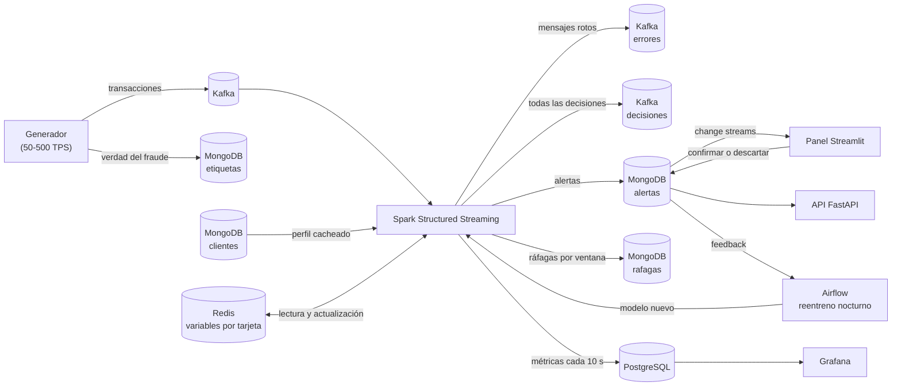

# Detección de fraude en tiempo real

Sistema de streaming de punta a punta que decide en segundos si un pago con tarjeta se aprueba, se revisa o se bloquea. Un generador envía transacciones a Kafka, Spark Structured Streaming las enriquece con el perfil del cliente (MongoDB) y con sus variables recientes (Redis), aplica cuatro reglas y un modelo de ML, guarda las alertas en MongoDB y publica las métricas en PostgreSQL para Grafana. Un panel en Streamlit recibe las alertas al instante mediante change streams y permite a los analistas confirmarlas o descartarlas. Cada noche, Airflow reentrena el modelo con ese feedback.

## Arquitectura



## Estructura

```
fraude-tiempo-real/
├── comun/              # configuración, esquema, features y utilidades compartidas
├── esquema/            # JSON Schema del mensaje de Kafka (único sitio)
├── generador/          # perfiles en MongoDB y productor de Kafka
├── streaming/          # Spark Structured Streaming
│   ├── reglas/         # funciones puras, una por regla, y motor de decisión
│   ├── enriquecimiento/  # caché de perfiles (MongoDB) y variables de tarjeta (Redis)
│   └── modelo/         # modelo calibrado y predictor con recarga en caliente
├── entrenamiento/      # histórico sintético, entrenamiento, evaluación y reentreno
├── panel/              # Streamlit con change streams
├── api/                # FastAPI sobre alertas, clientes, informes y métricas
├── grafana/            # datasource y tablero provisionados
├── mongo/              # JSON Schema de las colecciones e inicialización (índices, TTL)
├── postgres/           # tabla de métricas y base de datos de Airflow
├── dags/               # reentreno nocturno
├── carga/              # prueba de carga y comparativa Redis frente a MongoDB
├── docker/             # imágenes de la aplicación, de Spark y de Airflow
├── docs/               # informes generados
├── requirements/       # dependencias por componente
├── tests/
├── docker-compose.yml
└── README.md
```

## Arranque

Requisitos: Docker con Docker Compose v2 y unos 8 GB de memoria para los contenedores.

```bash
docker compose up -d --build
```

Ese comando levanta todo y lo deja funcionando sin pasos manuales:

1. Kafka en modo KRaft y `kafka-init`, que crea los topics `transacciones` (6 particiones), `errores` y `decisiones`.
2. MongoDB como réplica de un nodo. El healthcheck inicia el replica set y `mongo-init` aplica los validadores JSON Schema y los índices de `mongo/init.js`.
3. Redis, PostgreSQL (con la tabla `metricas` y una base de datos aparte para Airflow) y Grafana con el tablero ya cargado.
4. `perfiles` carga 1.000 clientes y `entrenamiento-inicial` entrena el primer modelo si no existe.
5. `streaming` (Spark 3.5 con Java 17), `generador` (100 TPS por defecto), `api`, `panel` y Airflow.

| Servicio | URL | Acceso |
|---|---|---|
| Panel de alertas | http://localhost:8501 | — |
| API (OpenAPI) | http://localhost:8000/docs | — |
| Grafana | http://localhost:3000 | admin / admin |
| Airflow | http://localhost:8080 | admin / admin |
| Spark UI | http://localhost:4040 | — |

Las credenciales, los umbrales y el ritmo del generador se cambian copiando `.env.example` a `.env` antes de arrancar. Por ejemplo, `TPS=300 docker compose up -d generador` cambia el ritmo sin tocar el resto.

### Ejecución desde el host

Los puertos de Kafka (9092), MongoDB (27017), Redis (6379) y PostgreSQL (5433) quedan publicados, y Kafka anuncia un listener externo en `localhost:9092`. Los valores por defecto de `comun/config.py` coinciden con `.env.example`, así que los scripts funcionan desde el host sin configuración adicional:

```bash
python -m venv .venv && source .venv/bin/activate
pip install -r requirements/dev.txt
python -m generador.productor --tps 200 --hora-inicio 03:00
```

La URI de MongoDB del host lleva `directConnection=true` porque el replica set anuncia el nombre interno `mongodb:27017`. La opción `--hora-inicio` desplaza el reloj simulado para provocar el patrón de compras de madrugada fuera de esa franja horaria.

## Flujo de una transacción

1. **Esquema único.** `esquema/transaccion.json` define el mensaje. El productor valida con `jsonschema`. En Spark, el `StructType` y todas las comprobaciones (campos obligatorios, tipos, enumeraciones, patrones, rangos y fechas) se derivan de ese fichero en `streaming/esquema_spark.py`, sin duplicarlo.
2. **Cola de errores.** Lo que no cumple el esquema (JSON roto, campos que faltan o sobran, tipos o valores no válidos) se publica en el topic `errores` con el mensaje original, el motivo, la partición y el offset.
3. **Enriquecimiento por partición.** `mapInPandas` procesa cada partición de Kafka con una conexión a Redis y otra a MongoDB por proceso de Python. Nunca se hace `collect()` del lote en el driver. El perfil sale de una caché que se precarga al arrancar y refresca cada entrada a los 5 minutos.
4. **Variables en Redis.** Se leen el historial de la tarjeta de las últimas 24 h y la marca de ráfaga, se calculan las features con `comun/features.py` y solo después se registra la compra.
5. **Reglas y modelo.** Las cuatro reglas son funciones puras `(transacción, features, perfil) → resultado | None`. El modelo puntúa de 0 a 1 todas las transacciones del lote a la vez.
6. **Decisión.** Cada transacción sale con `APROBADA`, `REVISAR` o `BLOQUEADA` y su lista de motivos. Todas las decisiones se publican en el topic `decisiones`, que es lo que consumiría la pasarela de pagos, y las que no son `APROBADA` se guardan como alerta.
7. **Ventanas con watermark.** Una segunda consulta cuenta las compras por tarjeta en ventanas de 1 minuto que avanzan cada 10 s sobre la hora del evento, con un watermark de 2 minutos y estado en RocksDB. Las ventanas con más de 5 compras se guardan en `rafagas` y marcan la tarjeta en Redis durante 10 minutos, de modo que las compras siguientes se bloquean aunque hayan llegado desordenadas.
8. **Métricas.** Cada 10 s se escribe en PostgreSQL una fila con las transacciones por segundo, el porcentaje de bloqueadas y revisadas y la latencia media y máxima. La latencia va desde que el productor envía el mensaje (timestamp de Kafka) hasta que se toma la decisión.

Las tres consultas (`errores`, `decisiones` y `ventanas`) tienen su propio checkpoint en `CHECKPOINT_DIR`, así que tras un reinicio continúan desde el último offset confirmado.

## Generador

`generador/perfiles.py` crea los clientes de forma determinista (`CLI-00000`, `CLI-00001`…): el cliente *n* es siempre el mismo, lo que permite ampliar la población sin cambiar los existentes. Hay dos tipos con campos distintos en el mismo documento:

- **Particular:** `nombre`, `apellidos`, `edad`, `ocupacion`.
- **Empresa:** `razon_social`, `cif`, `sector`, `num_empleados`, `persona_contacto`.

Ambos llevan anidados sus tarjetas, sus comercios frecuentes, sus categorías habituales con el gasto medio y las compras al mes, y su horario típico.

`generador/transacciones.py` produce el tráfico normal y estos patrones de fraude (1,5 % por defecto):

| Patrón | Qué genera |
|---|---|
| `viaje_imposible` | Una compra legítima en la ciudad del cliente y, entre 3 y 20 minutos después, otra con la misma tarjeta en una ciudad a más de 350 km |
| `prueba_tarjeta` | De 6 a 10 compras online de 0,50 € a 3 € en menos de 45 s en un comercio que el cliente no usa |
| `importe_desproporcionado` | Una compra de 10 a 14 veces el gasto medio del cliente en esa categoría |
| `madrugada_inusual` | Entre las 0:00 y las 6:00 (hora de Madrid), una compra en una categoría y un comercio que el cliente no usa |

- **Fraude sin truncar.** La tasa de fraude se acumula entre intervalos, de modo que también se respeta a 50 TPS.
- **Mensajes tardíos.** Un 3 % de los mensajes se envía entre 5 y 150 s tarde, conservando su hora original. Llegan desordenados y algunos superan el watermark.
- **Etiquetas aparte.** La etiqueta de fraude no viaja en el mensaje: se guarda en la colección `etiquetas` para poder medir después la precisión real.
- **Mensajes rotos.** Con `--tasa-mensajes-rotos 0.01` se envían mensajes defectuosos para comprobar la cola de errores.

**Tamaño de la población.** Para que el tráfico normal no dispare la regla de frecuencia, una tarjeta no repite compra normal antes de `INTERVALO_MINIMO_TARJETA_S` (15 s). Así nunca supera 5 compras en un minuto. Por tanto, las tarjetas necesarias son TPS × 15:

| | Valor |
|---|---|
| 1.000 clientes | 2.137 tarjetas, 2,14 por cliente |
| TPS que admiten (2.137 / 15) | 142 |
| Tarjetas necesarias para 500 TPS (500 × 15) | 7.500 |
| Clientes necesarios para 500 TPS (con un 20 % de margen) | 4.212 |

El productor avisa si la población se queda corta, y `carga/prueba_carga.py` amplía la colección `clientes` automáticamente antes de empezar.

## Reglas y decisión

| Regla | Condición | Gravedad | Datos |
|---|---|---|---|
| Frecuencia | Más de 5 compras de la tarjeta en el último minuto, o ráfaga detectada por la ventana | alta | Redis |
| Viaje imposible | Más de 300 km respecto a la compra anterior en menos de 30 minutos | alta | Redis |
| Importe inusual | Más de 5 veces el gasto medio del cliente en esa categoría | media | Perfil en MongoDB |
| Comportamiento | Comercio no habitual **y** categoría no habitual **y** fuera del horario típico | media | Perfil en MongoDB |

La decisión combina reglas y modelo (`streaming/reglas/motor.py`). La puntuación del modelo es una probabilidad calibrada: `UMBRAL_REVISION` vale 0,3 y `UMBRAL_BLOQUEO` vale 0,6.

| Decisión | Cuándo |
|---|---|
| `BLOQUEADA` | Una regla alta, dos medias, una media junto con una puntuación de revisión, o una puntuación de bloqueo |
| `REVISAR` | Una regla media sola, o una puntuación entre los dos umbrales |
| `APROBADA` | Ninguno de los casos anteriores |

## Redis como feature store

| Clave | Tipo | Contenido | TTL |
|---|---|---|---|
| `tarjeta:{id}:historial` | sorted set | Compras de las últimas 24 h, con la hora del evento como puntuación y `id\|importe\|lat\|lon` como miembro | 25 h |
| `tarjeta:{id}:rafaga` | string | Marca que pone la ventana de Spark cuando hay más de 5 compras en un minuto | 10 min |

Una sola lectura en pipeline devuelve la última ubicación y su hora, las compras del último minuto y el gasto de 24 h.

- **Desorden y reintentos.** La compra anterior es la de hora de evento inmediatamente anterior, excluida la propia transacción. Por eso los mensajes desordenados y los reintentos de Spark no corrompen el estado.
- **Escrituras idempotentes.** `ZADD` del mismo miembro no cambia nada.
- **Memoria acotada.** Redis arranca con `maxmemory-policy volatile-ttl`: si se llena, expulsa primero lo que antes iba a caducar.

**Por qué Redis y no MongoDB para estas variables.**

- **Lectura.** Se consultan en cada transacción, cientos de veces por segundo, dentro del presupuesto de 5 s. Redis las sirve desde memoria en un solo viaje de red, con estructuras pensadas para ventanas deslizantes (sorted sets con rangos por puntuación).
- **Escritura.** Cada compra añade una entrada y recorta lo que tiene más de 24 h; en MongoDB eso sería una actualización de documento con índices y journal.
- **Caducidad.** Los TTL de Redis son exactos y a nivel de clave, mientras que el monitor TTL de MongoDB pasa cada 60 s.

Los datos son efímeros y reconstruibles, así que no necesitan la durabilidad de MongoDB. `carga/benchmark_lecturas.py` mide las dos opciones con la misma información.

## MongoDB

| Colección | Contenido | Índices |
|---|---|---|
| `clientes` | Un documento por cliente con tarjetas, comercios, categorías y horario anidados | `ciudad`, `tipo`, `tarjetas.tarjeta_id` (único) |
| `alertas` | Transacción completa, motivos, detalle de cada regla, puntuación, features, foto del perfil en ese momento, estado y latencia | `{estado, fecha}`, `{cliente_id, fecha}`, `{motivos, fecha}`, TTL de 30 días sobre `descartada_en` |
| `etiquetas` | Verdad del generador (solo fraudes) | TTL de 7 días |
| `rafagas` | Ventanas con más de 5 compras | `{tarjeta_id, ventana_inicio}`, TTL de 7 días |

- **Documentos anidados.** La decisión necesita el perfil entero de una vez y no se consulta por partes. Con un único documento por cliente basta una lectura por `_id`, sin joins, y la caché guarda un objeto ya listo. Las tarjetas, categorías y comercios de un cliente están acotados y no se comparten con otros clientes, que es el caso ideal para anidar. Las alertas sí van en su propia colección porque crecen sin límite, tienen su propio ciclo de vida (estados y TTL) y se consultan por fecha y estado.
- **Esquema flexible con control.** `mongo/esquemas/clientes.json` exige los campos comunes y usa `oneOf` para obligar a que un particular tenga sus campos y una empresa los suyos. Las alertas también tienen validador. Los mismos ficheros se usan en los tests para validar los documentos que produce el código.
- **TTL de descartadas.** Al marcar una alerta como `FALSO_POSITIVO` se fija `descartada_en`, y el índice TTL la elimina 30 días después. Si se vuelve a marcar como fraude, el campo se quita y la alerta ya no caduca.
- **Informes con aggregation pipeline** (`comun/informes.py`, expuestos en la API y en el panel):
  - Alertas por motivo y día: `$match`, `$unwind`, `$group` por día (UTC) y motivo.
  - Porcentaje de falsos positivos por regla: `$match`, `$unwind`, `$group`, `$project`.
  - Precisión real por motivo: `$lookup` contra `etiquetas`, `$unwind`, `$group`.
- **Change streams.** Requieren réplica, por eso MongoDB arranca con `--replSet`. El panel abre `watch()` en un hilo con `fullDocument: updateLookup` y guarda el token para reanudar si se corta la conexión. Las alertas nuevas y los cambios de estado llegan por empuje, sin consultar MongoDB periódicamente. La interfaz solo vuelve a pintar el búfer en memoria cada 2 s.

## Modelo

- **Mismas features en entrenamiento y servicio.** `comun/features.py` calcula las features en el streaming y en el entrenamiento, así que no hay diferencias entre ambos.
- **Histórico de entrenamiento.** Se genera con el mismo generador: 2 días, 1.000 clientes, curva de actividad diaria y estado de tarjeta simulado con `EstadoTarjetasMemoria`, que replica la semántica de Redis (un test lo comprueba).
- **Algoritmo.** Un Isolation Forest aprende el comportamiento normal y una regresión logística sobre su puntuación de anomalía la calibra como probabilidad de fraude entre 0 y 1 (`streaming/modelo/modelo.py`).
- **Validación.** `python -m entrenamiento.entrenar` usa el último 20 % del histórico como validación y guarda la precisión media, el AUC, la precisión y el recall en `modelo.metricas.json`.
- **Recarga en caliente.** El streaming recarga el modelo cuando cambia el fichero, sin reiniciar.

### Comparativa de reglas, modelo y combinación

Resultado de `python -m entrenamiento.evaluar` (`docs/evaluacion.md`) sobre un día sintético que no se usó en el entrenamiento: 86.400 transacciones, 1.297 de ellas fraudulentas, con los umbrales por defecto.

| Estrategia | Alertas | Fraudes detectados | Falsos positivos | Precisión | Recall |
|---|---|---|---|---|---|
| Solo reglas | 796 | 740 | 56 | 0,930 | 0,571 |
| Solo modelo | 1.452 | 909 | 543 | 0,626 | 0,701 |
| Reglas y modelo | 1.769 | 1.171 | 598 | 0,662 | 0,903 |

- **Reglas.** Son muy precisas y detectan el 100 % de los viajes imposibles, de los importes desproporcionados y de las compras de madrugada. Sin embargo, solo detectan el 46 % de las pruebas de tarjeta, porque las cinco primeras compras de la ráfaga no superan el umbral.
- **Modelo.** Detecta el 86 % de las pruebas de tarjeta.
- **Combinación.** Junta las dos fortalezas: 90 % de recall con un 0,7 % de transacciones legítimas enviadas a revisar o bloqueadas. La mayoría de esos falsos positivos son compras legítimas de madrugada, fuera del horario del cliente.

Son datos sintéticos: los valores sirven para comparar estrategias, no como estimación de un entorno real.

### Reentreno nocturno

El DAG `reentrenar_modelo_fraude` se ejecuta a las 3:00 (Europe/Madrid), con 2 reintentos:

1. **Exportar feedback.** Exporta las alertas revisadas por los analistas con sus features (`FRAUDE_CONFIRMADO` = 1, `FALSO_POSITIVO` = 0).
2. **Entrenar el candidato.** Lo entrena con el histórico más ese feedback, que pesa 5 veces más.
3. **Comparar.** Compara candidato y modelo en producción por precisión media sobre la misma validación: un histórico reservado más un 30 % del feedback, elegido por hash del identificador.
4. **Desplegar.** Solo despliega si el candidato mejora, con un reemplazo atómico en el volumen compartido `modelos`.

## Métricas y paneles

- **Grafana** (`grafana/dashboards/fraude.json`): muestra las transacciones por segundo, el porcentaje de bloqueos y revisiones y la latencia media y máxima, con umbrales en 2 s y 5 s. Se refresca cada 5 s.
- **Panel Streamlit:**
  - Alertas en vivo, con botones para confirmar el fraude o marcar un falso positivo.
  - Mapa de alertas.
  - Métricas de PostgreSQL.
  - Informes de MongoDB.
- **API:**

| Endpoint | Qué devuelve |
|---|---|
| `GET /alertas` | Alertas filtradas por fecha, estado, decisión y cliente, con paginación |
| `GET /alertas/{id}` | Una alerta |
| `PATCH /alertas/{id}/estado` | Cambia el estado de la alerta |
| `GET /clientes/{id}` | Un cliente |
| `GET /informes/alertas-por-motivo` | Alertas por motivo y día |
| `GET /informes/falsos-positivos` | Porcentaje de falsos positivos por regla |
| `GET /informes/precision` | Precisión real por motivo |
| `GET /metricas/resumen` | Resumen de las métricas de PostgreSQL |

## Semántica de entrega

- **At-least-once de extremo a extremo.** Spark guarda los offsets de Kafka en el checkpoint y solo los confirma cuando termina el lote. Si se cae a mitad, vuelve a procesar el lote entero, por eso cada salida es idempotente o tolera duplicados.
- **Productor.** Usa `acks=all` y `enable.idempotence=true`, así que los reintentos no duplican mensajes en `transacciones`.
- **Alertas.** Hacen `upsert` con `_id = id_transaccion` y `$setOnInsert`. Un reproceso no crea duplicados ni pisa el estado que haya puesto un analista. A efectos prácticos es exactly-once.
- **Redis.** El historial es un sorted set con un miembro por transacción, así que reescribirlo no cambia nada. Las features se calculan excluyendo la propia transacción y con la compra anterior según la hora del evento, de modo que un reproceso en orden obtiene la misma decisión (hay un test para ello).
- **Topics `decisiones` y `errores`.** Pueden recibir duplicados tras un fallo. Los consumidores deben deduplicar por `id_transaccion`, como hace la prueba de carga.
- **Métricas.** Un lote reprocesado puede contarse dos veces en una ventana de 10 s, algo aceptable para métricas operativas.
- **Exactly-once estricto.** Exigiría transacciones de Kafka de extremo a extremo y sinks transaccionales. El sink de Kafka de Spark no las ofrece, y MongoDB y Redis quedarían fuera de esa transacción. Las escrituras idempotentes dan el mismo resultado observable con mucho menos coste y latencia.

## Calidad

```bash
pip install -r requirements/dev.txt
ruff check . && ruff format --check .
pytest --cov
```

- **Tests de reglas y estado.** Cada regla, el motor de decisión, las features y el estado de tarjeta se prueban con datos fabricados. Redis se sustituye por `fakeredis`, con un test de equivalencia entre Redis y la versión en memoria.
- **Tests de generador y productor.** Se comprueban los patrones de fraude, la tasa, los retrasos y el intervalo por tarjeta, y el planificador de envíos con un reloj falso.
- **Tests de MongoDB y API.** El procesado por partición, la idempotencia, la caché de perfiles, los informes, el oyente de change streams y la API se prueban contra `mongomock`.
- **Tests de Spark.** Cubren el parseo, la cola de errores, las ventanas con watermark, `mapInPandas` y el `foreachBatch` en una sesión local. Spark 3.5 necesita Java 17: con Java 21 Arrow falla y el test de `mapInPandas` se omite.
- **Tests del modelo.** Cubren el entrenamiento, la calibración, el guardado, la recarga en caliente, la evaluación y el reentreno.
- **CI.** GitHub Actions (`.github/workflows/ci.yml`) instala `requirements/dev.txt` con Java 17 y ejecuta `ruff` y `pytest`. Airflow no se instala en CI porque sus dependencias chocan con las del proyecto, así que el test del DAG se omite y se valida en la imagen de Airflow.

## Prueba de carga y comparativa de latencias

Con el stack levantado, primero se para el generador para no mezclar tráfico:

```bash
docker compose stop generador
python -m carga.prueba_carga --tps 500 --duracion 300
```

- **Qué hace.** Amplía la población si hace falta, envía 500 TPS durante 5 minutos y consume el topic `decisiones`. Para cada transacción mide la latencia de extremo a extremo, desde el envío hasta la decisión recibida.
- **Qué guarda.** Escribe en `carga/resultados/` la media, p50, p95, p99 y máximo, el porcentaje de decisiones por debajo de 5 s y las transacciones sin decisión.

```bash
python -m carga.benchmark_lecturas --tarjetas 10000 --lecturas 20000
```

Compara la lectura de las variables de una tarjeta en Redis (pipeline real del streaming) con un `find_one` del documento equivalente en MongoDB, y guarda los percentiles en `carga/resultados/`.

Los dos resultados dependen de la máquina, así que no se publican aquí: hay que generarlos con los comandos anteriores.

## Configuración

Todas las variables están en `comun/config.py` y documentadas con sus valores por defecto en `.env.example`:

| Variable | Qué controla |
|---|---|
| `TPS` | Transacciones por segundo del generador |
| `TASA_FRAUDE` | Proporción de transacciones fraudulentas |
| `TASA_RETRASO` | Proporción de mensajes enviados tarde |
| `UMBRAL_REVISION`, `UMBRAL_BLOQUEO` | Umbrales del modelo |
| `WATERMARK` | Retraso máximo admitido en las ventanas |
| `TTL_HISTORIAL_S`, `TTL_RAFAGA_S` | Caducidad de las claves de Redis |
| `PERFIL_CACHE_TTL_S` | Refresco de la caché de perfiles |
| `INTERVALO_METRICAS_S` | Cada cuánto se escriben las métricas |
| `KAFKA_OFFSETS_INICIALES` | Offset de arranque: `earliest` en Docker para no perder lo enviado antes de que Spark arranque |

## Licencia

MIT
